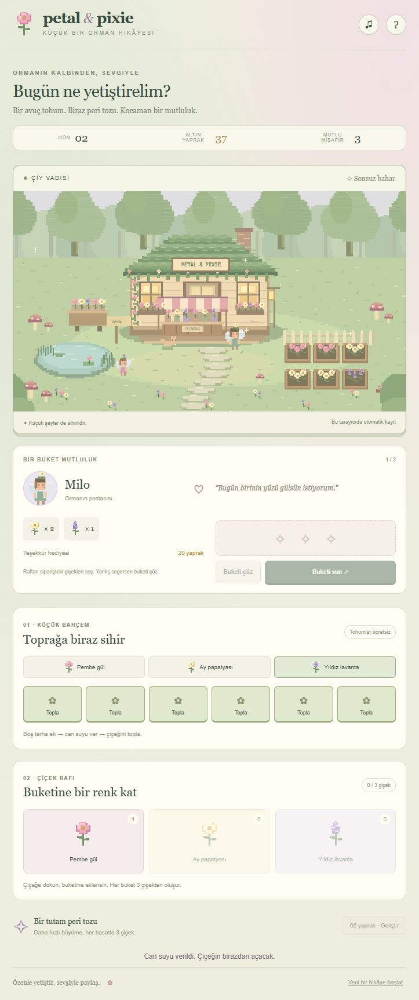

# Petal & Pixie ✿

**A tiny flower shop. A little fairy magic. A slower kind of game.**

A playable, cozy 2D pixel-art flower-shop game with a Turkish interface. Grow flowers in a woodland garden, arrange bouquets for fairy visitors, and spend golden leaves on garden upgrades. No countdown pressure, game-over screen, accounts, or paid resources.



## Play locally

Requires Python 3 for the local server. No package installation or build step.

```sh
git clone https://github.com/kubraaysekilic/petal-and-pixie.git
cd petal-and-pixie
python -m http.server 5175 --bind 127.0.0.1
```

Open **http://127.0.0.1:5175**. Serve over HTTP; double-clicking `index.html` is not supported because the game uses ES modules. Stop the server with Ctrl+C.

## How to play

1. Choose a rose, moon daisy, or star lavender seed. Seeds are free.
2. Click an empty garden bed, then click it again to water. Harvest after 8–12 seconds. The six buttons below the scene also control the beds.
3. Check the visitor's recipe. Select exactly three flowers from the shelf. **Buketi çöz** returns all reserved flowers without loss.
4. Deliver the matching bouquet to earn golden leaves. Complete three orders to start the next day.
5. Buy fairy dust upgrades for 35 and 65 leaves: future watering takes 20% / 40% less time, and harvests yield 2 / 3 flowers.

Visitors never leave impatiently. You can grow flowers between orders, and a free seed supply prevents a dead end. Initial stock lets you learn bouquet making right away.

## Features

- Original 640 × 360 Canvas pixel woodland: moss-roof shop, striped awning, pond, mushrooms, flower cart, fairies, cat and fireflies.
- Three original SVG pixel flower sprites, also used in the interface.
- Six interactive beds, four recurring visitors, rotating recipes and endless day progression.
- Inventory reservation, reversible bouquets, rewards and two upgrades.
- Local autosave with validation and an explicit confirmation before resetting progress.
- Responsive layout, keyboard-operable controls, focus indicators, accessible names and reduced-motion support.
- Optional synthesized bell chimes using Web Audio; sound starts only after a user action.
- No runtime dependencies, external fonts, analytics or network calls from game code.

## Technology and structure

Vanilla JavaScript ES modules, HTML, CSS, Canvas 2D, SVG, Web Audio and localStorage.

```text
src/game.js       Pure gameplay rules and save validation
src/art.js        Original procedural pixel scene and characters
src/main.js       DOM controls, animation, persistence and audio
assets/           Original flower SVG sprites
style.css         Responsive interface
index.html        Accessible game controls and dialogs
tests/            Node built-in test suite
docs/             Actual gameplay screenshots and verification
```

## Tests

Node.js 22 or later is needed only for testing:

```sh
npm test
```

Tests cover growing, exact harvest timing, inventory conservation, wrong-order rejection, rewards, day transitions, upgrades, invalid inputs and corrupt saves. See [verification notes](docs/VERIFICATION.md).

## Artwork

All artwork was created specifically for this project in source code: integer-grid Canvas drawing in `src/art.js` and hand-authored SVG paths in `assets/`. No purchased packs, copied sprites, stock pictures or external image-generation service were used. The screenshot shows the actual running game, not a concept mockup. All art remains editable alongside the source.

## Scope

This is a small complete browser game, not a multiplayer or backend service. Saves belong to one browser origin; changing the port, clearing browser storage or using a different device does not share progress. If storage is unavailable, the game remains playable for the current session and displays a notice. Growth uses the device clock; already watered flowers can be harvested after returning. Existing growth timers do not change when an upgrade is bought. The UI is Turkish; source documentation is English.

To host on GitHub Pages, use **Settings → Pages → Deploy from a branch → main / (root)**. The game uses relative URLs and requires no server backend.
